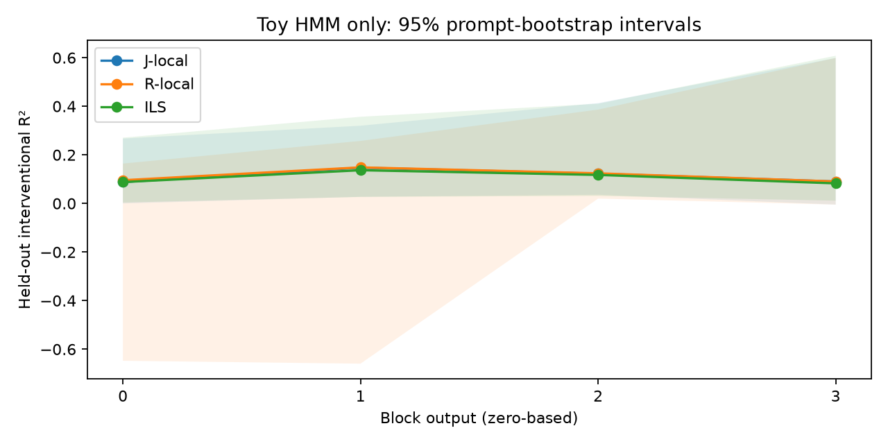
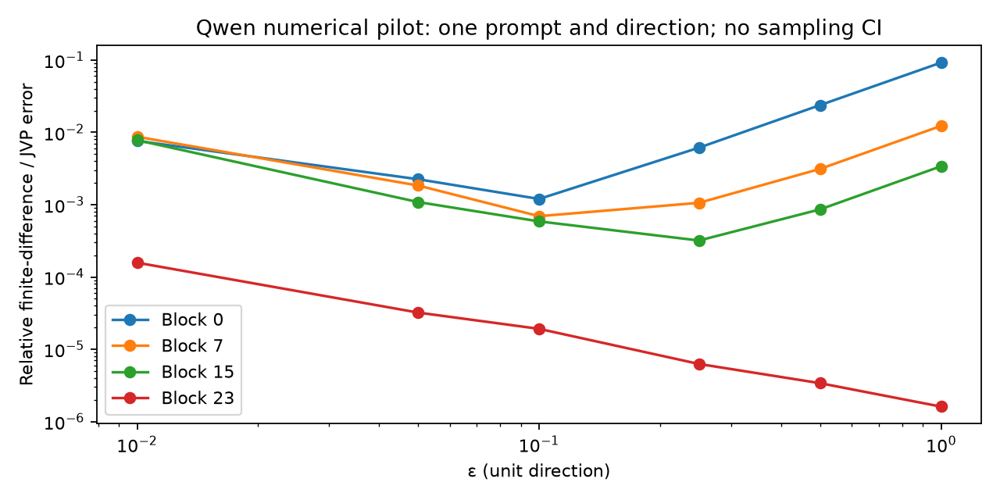

# ILS-lens research report — incomplete Qwen study

Updated 2026-11-06. **The requested research criteria are not yet met.** Completed
measurements are the Qwen numerical/reference benchmarks and the trained toy HMM
experiments below. Production Qwen experiment runners are implemented but their
presence is not a result. Long CPU runs were stopped at the owner's request;
the RTX 3060 became available and numerical GPU validation has started. Missing measurements
are unknown, not null findings.

Full production execution is disabled during the specification audit. Independent
numerical validation can run on the GPU. The current implementation is
not an exact implementation of the entire proposal.

The initial fp32 GPU suffix benchmark completed: six-epsilon antithetic batches
at source position 64 took 0.2033, 0.1279, 0.0659 and 0.000575 seconds at blocks
0, 7, 15 and 23 respectively, averaged over three repetitions. See
[the timing artifact](artifacts/qwen-gpu-suffix-benchmark.json). These timings
exclude data loading and do not establish scientific validity. The all-layer
isotropic-limit validation was launched separately with an unbenchmarked
24-hour / 3-GB estimate; its results are pending.

## Partial GPU numerical checkpoint audit

A read-only snapshot of completed blocks 0–6 contains 21 isotropic-limit matrix
comparisons (8 contexts × 896 directions per cell). Float64 reductions of the
saved fp32 matrices give the following cosines against our normalized-horizon J:

| Block | ε=.01 | ε=.001 | ε=.0001 |
|---|---:|---:|---:|
| 0 | 0.99996196 | 0.99999982 | 0.99998251 |
| 1 | 0.99997944 | 0.99999980 | 0.99998069 |
| 2 | 0.99999506 | 0.99999971 | 0.99997084 |
| 3 | 0.99999888 | 0.99999957 | 0.99995824 |
| 4 | 0.99999919 | 0.99999951 | 0.99995194 |
| 5 | 0.99999925 | 0.99999950 | 0.99995151 |
| 6 | 0.99999969 | 0.99999944 | 0.99994484 |

These are numerical checks conditional on the fixed test inputs, not population
estimates or evidence of ILS superiority; no sampling CIs are claimed. The original
fp32 reductions occasionally exceed 1 by about 0.00002. Both reductions are
preserved in [the audit artifact](artifacts/numerical-partial-cosine-audit.json),
with input-file hashes and source commit. The matrices and running experiment
remain unchanged. The read-only audit took 0.23 seconds excluding Python startup.

This is **not** the completed equivalence test: held-out top-10 overlap is not
stored in the intermediate matrix files, and later blocks are still running.
The numerical job retains its original prefix-sampled contexts; primary fitting
uses the separately corrected shuffled bank. The primary launch gate still waits
for the complete registered all-layer result. Reproduce this snapshot with
`scripts/audit_numerical_checkpoint_cosines.py --run runs/numerical-proposal-v2
--max-layer 6 --output artifacts/numerical-partial-cosine-audit.json`.

## Analytic horizon limitation (not a Qwen measurement)

At the final block, antithetic interventions give exactly
`Delta y_gamma = w_gamma(0 | t) delta`: only the source position changes. The
normalized horizon weight depends on source position. Therefore one global
matrix can have low coverage even when every conditional map is perfectly linear.
For uniform valid source positions, zero-mean perturbations independent of
position, and the same nonzero covariance at every position, the population
optimal matrix is `E[w] I`, with `R2 = E[w]^2 / E[w^2]`.

| Horizon gamma | Optimal global population R² | Upstream identity population R² |
|---|---:|---:|
| 0 | 1.0000 | 1.0000 |
| 0.5 | 0.9903 | 0.0557 |
| 0.9 | 0.6101 | -29.6142 |
| 1.0 | 0.1542 | -61.3812 |

These are analytic values, not estimated effects; sampling CIs do not apply.
The upstream identity targets a sum, whereas these responses use normalized
horizons. Its poor scores illustrate estimand mismatch, not a discovery of
inferior causal understanding. Donor perturbations may depend on position and
need not obey the assumptions, so this table is not their performance ceiling.
The specification's estimator and horizons remain unchanged. Low global lens
coverage alone cannot establish curvature or absent workspace structure.

[Diagnostic artifact](artifacts/final-horizon-diagnostic.json),
[reproduction script](scripts/check_final_horizon.py). Tests check the exact
position-dependent map against a tiny Qwen suffix and the population formula
against a balanced positive/negative basis dataset.

## Fitting-corpus sampling correction before primary execution

A corpus audit found that the original first-eligible-row sampler assigned 15
of 16 source paragraphs to *Valkyria Chronicles III* and 14 of 16 donor paragraphs
to *Tower Building of the Little Rock Arsenal*. This was a narrow, mismatched
bank, not a representative random selection from WikiText train. The waiting
primary controller was stopped before any primary fits or intervention collection.
The old benchmark and numerical-validation contexts are retained as exploratory
provenance; the running numerical test is unchanged.

The replacement sampler uses a fixed CPU-generator seed of 101 to permute all
row indices, then takes eligible rows in that order (at least 600 characters and
128 tokens). It still truncates each row to 128 tokens. Source and donor banks
are disjoint consecutive portions of the same permutation; J/R/J++ receive their
32-row union. This is a documented sampling-method correction based on corpus
structure, with no evaluation labels or outcomes used. The new 16-row source
and donor banks each contain 16 distinct articles. This small budget still limits
generalization; article diversity does not establish representativeness.
See [the reproducible audit](artifacts/wikitext-sampling-audit.json) and
[sampler audit script](scripts/audit_wikitext_sampling.py).

New row provenance and resumable-experiment fingerprints include the sampling
policy. Old caches reject the changed protocol; primary execution uses a new
output directory and a fixed checkout. Tests verify deterministic selection,
disjoint banks, baseline union equality, eligibility, and unchanged global RNG.
The numerical job launched at commit e9e5c90 must be resumed from that commit if
necessary; new sampler code must not be used with its existing checkpoints.

## Specification corrections and a failed graph criterion

The web/chat corpus iterator now filters document kind before tokenization. The
old pair of streams tokenized documents of both kinds before discarding the
unwanted kind, making the first chat window scan and tokenize the entire preceding
web portion. The corrected iterator preserves split membership, window tokens,
window hashes, ordering, deduplication and mixture weights. A regression test
compares every output window and provenance record while verifying that only the
selected document kind is tokenized. The waiting corpus builder will use this
validated loader for its budget audit; document-count and token-budget settings
are unchanged. No model data or evaluation outcomes motivated this efficiency
change, and no production throughput speedup has been measured yet.

Primary cross-validation now reuses zero-penalty candidate scores across priors.
At λ=0 the prior term vanishes for ridge, Huber IRLS and prompt-block MoM, so
repeating their fold fits for I/J/R adds computation without changing the
estimator. All candidate rows remain present, their order is unchanged, and ties
retain the original first-candidate rule. A reference test covers all three
estimators and verifies exact candidate-score and winner equality plus equal
final matrices; 30 redundant fold fits are removed in that test. Nonfinite CV
predictions now fail explicitly instead of entering candidate selection. No
production fitting outcomes motivated the optimization. Only the waiting primary
controller is requeued from the validated source; numerical validation continues
on its original checkpoint convention. No GPU wall-time savings are claimed yet.

Contrastive split-half nulls now reuse per-prompt activation/readout sums and
batch the vocabulary projections. The same seeded prompt permutations are
retained; normalization uses each half's actual position count, so unequal
numbers of positions per prompt preserve the original sample-weighted estimand.
Tests compare both readout modes with the unbatched reference and verify the
reduced readout call count. No GPU wall-time speedup is claimed yet.

Flat observed contrasts now retain their deterministic target rank but have
undefined rank significance. A constructed zero-contrast test shows why: the
target's ID tie-break yields observed rank 1 while every control split yields
rank 2, giving a rank-only p-value of 1/1001 despite zero effect. Such a value
would not justify concept detection. The new output records
`rank_test_status=undefined_flat_contrast` and a null p-value, preserving all
1,000 null ranks. Nonflat contrasts retain the specified rank-null comparison.
The planted runner's protocol fingerprint changes. No production contrastive
results preceded this correction.

Held-out faithfulness evaluation now shares each antithetic forward pair and its
per-position token log probabilities across all pending horizon kernels. The old
runner reset the same sampling seed and repeated those calculations once per
horizon. The source/donor draws, predictions, bootstrap groups and estimands are
unchanged. With all four horizons pending, this removes fourfold duplication of
branch evaluation and actual-log-probability computation, not all evaluation
work; no GPU wall-time speedup is claimed yet. Per-horizon matrices are retained
on the device for the current layer. Tests compare the shared reductions with
independent per-position definitions, count branch/readout calls, and verify
unchanged-cache resume and changed-matrix rejection. The cache protocol changes
because fp32 reduction ordering can differ. No primary evaluation result was used
to choose this implementation change.

Sparse-pursuit stopping previously compared the best new atom's squared projection
with the random-dictionary threshold before applying the constrained gradient
step. Those gains need not equal the actual marginal reconstruction improvement.
A deterministic synthetic counterexample (seed 18, dimension 16, 40 atoms,
iteration 6) gives candidate gain 1.02693 but achieved gain 0.85648. The corrected
procedure forms the candidate step, measures the actual reduction in squared
residual norm, and accepts only if it exceeds the existing 95th-percentile null.
The null remains the best nonnegative one-atom gain from an isotropic random
dictionary of matched size and row norms, sampled by its exact order-statistic
distribution. No evaluation labels select this rule. Tests force a 0.9 threshold
to verify rejection of the counterexample step and preservation of the prior
coefficients, and verify an empty decomposition for a zero dictionary. Readout
results identify the new pursuit protocol. No production sparse readout results
preceded this correction.
The first counterexample fixture failed validation because its diagnostic search
continued after a zero-gain stopping point. That unreachable fixture (seed 14)
was rejected and replaced with the reachable seed-18 example. Commit 6b9b159
was pushed before its failing test result was checked; the follow-up commit
records and corrects the fixture. The actual-gain acceptance rule was not relaxed.

A dedicated all-layer transcoder benchmark now precedes the 100M-token training
stage in the full-study runner. It performs three warmup and ten measured updates
with the registered width, TopK, Adam optimizers and feature-activity tracking,
then discards the benchmark weights. It reports raw update times, optimizer-state
bytes, peak CUDA memory and a linear update-time projection. WikiText is only a
timing proxy: the projection excludes web/chat tokenization, corpus auditing,
deduplication, checkpoint I/O and evaluation. These exclusions prevent treating
it as a total completion-time estimate. A tiny integration test verifies all-layer
optimizer allocation and the projection arithmetic. The production GPU benchmark
has not yet run; it must be measured before the full transcoder training launch.

Transcoder evaluation now computes centered float64 reporting moments from fp32
model outputs, replacing cancellation-prone subtraction of raw fp32 moments.
The model, gradients and training remain fp32. Window-level moments merge with
between-window mean corrections, including repeated windows in document bootstrap
samples. Zero output variance and equal clean/ablated cross-entropy produce
explicitly undefined ratios rather than NaNs that would fail JSON serialization.
Intervals require at least 20 finite bootstrap replicates; undefined replicate
counts are retained. At least two distinct held-out documents are required for
document-bootstrap intervals. Held-out moments, window provenance and all three
per-window CE measurements are saved for independent reaggregation. Tests cover
small variance on a large offset, repeated windows, constant outputs, equal CE
and undefined resamples. A tiny end-to-end training/evaluation test loads the
saved window statistics and independently reproduces each reported layer variance
and the all-MLP CE-recovery ratio. The evaluation protocol changes; no production Qwen
transcoder measurements preceded this correction.

Faithfulness-cell caches now bind the actual lens-matrix hashes, primary fitting
metadata, and source/donor row provenance. Previously the experiment fingerprint
covered evaluation settings but did not identify the matrices, so changing a
fitted artifact could silently reuse old cell measurements. Each cell now records
its input fingerprint and a provenance sidecar; missing or changed bindings raise
an error instead of reusing the result. An integration test resumes an unchanged
cell without recomputing effects, then changes its ILS matrix and verifies that
resume is refused. The protocol version changes; no production faithfulness
results preceded this correction. The all-layer audit also verified that the
J++ fitter already includes an explicitly labeled analytic final-block identity
under the upstream summed-target convention.

The measured-table exporter previously omitted nested dictionaries containing
fields beyond `mean` and `ci`. This would have dropped undefined-case counts,
selected prior/penalty/estimator details, native-estimand intervals and polar
diagnostics from generated summaries. It now preserves these as dot-separated
columns, retains short interval arrays and null values, and rejects ambiguous
column-name collisions. Long raw-sample arrays remain in their original result
files. Each exported stage includes the source result file's SHA-256 digest.
Regression tests check preservation of negative R², undefined outcomes, interval
bounds, fit selections and diagnostic quantities. This is a reporting correction;
no measured values or selection rules change.

The planted-organism model-difference diagnostic previously measured only held-out
WikiText contexts. It now additionally measures the matched behavioral prompts
and the four base-completion offsets used by the off-policy graph comparison.
Each perturbation is `h_tuned - h_base` at the same token context and site, and
its antithetic response runs through the base model with adapters disabled.
The fitted base ILS matrix predicts that response. Confidence intervals resample
prompts, keeping their four sites together. WikiText and behavioral-context R²
remain separate tables; neither is the fraction of the full tuned model's
behavioral trait explained. Short task prompts use skip0 and an appended,
excluded EOS sentinel, matching graph coverage and explicitly differing from
128-token skip16 fitting. A separate tiny-model test compares the response with
an independent copy of the base model and verifies adapter restoration. Input
length mismatches now raise rather than silently truncating paired contexts.
The run protocol changes, and the additional unbenchmarked time estimate is
14,400 seconds (28,800 total); actual stage timings remain required. No production
planted-organism results have been generated.

The Procrustes diagnostic now records raw expert-map dispersion, aligned-map
dispersion, positive-factor dispersion, and rotation chordal dispersion. For
square polar factors `A_k = U_k P_k`, the orthogonal solution makes
`U_k Q_k = U_0` by construction; aligned disagreement therefore reflects the
remaining `P_k` disagreement. This operation is useful to characterize the maps,
but its success does not identify rotation as the cause of expert disagreement.
Conversely, positive-factor disagreement can occur between purely linear maps
with different gains and is not itself evidence of curvature. A scaling-only
synthetic test preserves all disagreement after alignment; a mixed rotation and
scaling test verifies that aligned dispersion equals positive-factor dispersion.
The primary diagnostic still compares recall, interventional R² and effective
rank without selecting rotations using labels. Expert fitting provenance is
checked, and hashes of both expert and readout-state files bind cached results.
No Qwen Procrustes measurements have been completed.

Multilayer causal-gate auditing found that all-zero realized swaps were counted
as failed directional claims, and nonfinite scores could also silently become
failures. The band gate now retains zero-displacement interventions and
nonzero interventions with degenerate covariance as undefined (`passes=null`).
The observed score change remains recorded, but no random-direction comparison
is claimed. Nonfinite logits, transformed states, scores or covariances fail
explicitly. Pass-rate summaries report measured and undefined cases separately;
all-undefined groups have no pass rate. A new cache protocol prevents mixing old
and corrected results. Tiny-model tests instrument all 100 controls across two
layers and two positions, verifying the realized norm at every site and the
support of rank-one covariance draws. Control sizes match the observed lens
intervention's actual sequential displacements, including preceding layer
interventions; they are not recomputed from clean downstream states. No
production Qwen causal results preceded this correction.

Calibration auditing found that an unavailable GPD tail fit (fewer than 100
strict exceedances above the empirical 95th percentile) also incorrectly set
the empirical score standard deviation to zero. Discrete but varying reference
scores would therefore lose their z-scored readouts. The correction preserves
the actual standard deviation independently of tail availability. Such tokens
can have finite z scores, while their unsupported tail p-values remain
conservatively 1. Constant references retain undefined z scores. Nonfinite
reference scores fail explicitly. Production calibration artifacts are versioned,
and both the fitting and readout runners reject the old calibration version.
Tests cover rare exceedances, tied thresholds, constant scores and nonfinite
inputs. No production Qwen calibration results preceded this correction.

The token-change Spearman implementation previously applied normalization and
log-softmax to a horizon-averaged residual. This is not the actual averaged
change in token log probabilities. It now reads each perturbed final position
first, then averages its antithetic log-probability change with the horizon
weights. Lens predictions use the source state mapped by that lens, without
centering predictions on the observed final residual. The corrected protocol
has a new cache fingerprint. A regression test distinguishes these quantities.
No production Spearman results were generated with the old implementation.

Fitting-corpus exposure was also unequal: ILS used 16 source and 16 donor prompts
while fitted J/R/J++ used only the sources. All three fitted baselines now use
the same 32-prompt union. ILS retains the independent donor bank. Fold-specific
J/R priors use only training-fold sources plus the separate donor bank; held-out
source prompts are excluded. This equalizes corpus exposure, not the number or
distribution of derivative/intervention observations. J++ still additionally
uses labeled dev data and remains labeled accordingly. Configuration fingerprints
prevent reusing the old baseline shards as new-protocol artifacts.

Read-layer configurations now cover all 24 blocks. The transcoder configuration
now requests 100 million token presentations per layer. Its approximately
2.75-million-second estimate is a linear extrapolation, not a measured GPU cost.
Repeated presentations of the existing small corpus are not 100 million distinct
tokens. The trainer now preflights a finite, globally deduplicated training-window
stream and rejects overlap with validation windows before loading the model.
The existing corpus yields **2,557,568** distinct eligible tokens in the configured
mixture, so it correctly fails the 100M preflight. Larger pinned FineWeb and
UltraChat shards are being obtained; no 100M training run has occurred.

`QwenGraph.replacement()` implements live transcoder features plus the fixed
clean reconstruction error, freezing only attention patterns and RMS
denominators. It reproduces clean outputs on tiny inputs. A finite intervention
can change downstream TopK support, however, so the local derivative need not
equal the finite effect. The reproducible untrained four-layer diagnostic in
[replacement-semantics.json](artifacts/replacement-semantics.json) records relative
error **0.26489**, failing the requested **<0.001** criterion. Downstream support
changes number 60, 60 and 62 coordinates. This is a synthetic counterexample to
equating a local derivative with an arbitrary propagated finite intervention,
not a counterexample to a direct edge with its mediated paths excluded. It is
not a trained-model causal or workspace claim. No random-direction claim is made.

The previous independent-feature affine graph passes its own tests but uses an
extra freeze. Its existing results remain exploratory. Its runner now requires
an explicit `--exploratory-affine` flag. We have not relaxed the finite-edge
threshold, frozen additional gates in the new replacement, or represented the
failed criterion as success. Full graph attribution and budget closure under
the specified semantics remain unresolved. The current suite has **117 passing
tests**, including tests that correctly preserve this measured failure.

Inspection of [circuit-tracer's pinned implementation](https://github.com/decoderesearch/circuit-tracer/blob/255d989e93be1299d53d67b59e9fd76a0e274b14/circuit_tracer/replacement_model/replacement_model_transformerlens.py)
clarifies the estimand distinction: its direct attribution backward pass detaches
the non-skip MLP contribution, and constrained interventions freeze MLP outputs
while retaining skip changes. Thus our direct affine graph is structurally
consistent with that direct-effect convention. It is still distinct from a
propagated intervention in the live replacement with only attention/norms
frozen. Every checked exploratory edge now reports both measurements plus
original-model norms-only survival. The live result records support switches,
its own local-derivative error, and the direct-edge prediction error. A direct
edge passing does not assert that either propagated measurement passes.

The phrase dictionary now includes eligible targets from both the five readout
tasks and WorkspaceBench, while phrase evaluation remains on its declared
items. This fixes missing graph target rows caused by building the dictionary
only from WorkspaceBench. Penalties are still chosen solely by interventional
cross-validation. Targets outside 2–5 model tokens remain explicitly unsupported;
this change does not claim complete budget closure. The artifact audit now
explicitly rejects exploratory affine graph outputs as full proposal compliance
and checks distinct training tokens for the registered transcoder budget.

Readout exports now exclude masked/nonfinite entries rather than filling a
top-ten list with invalid token IDs when fewer than ten remain. Raw and z-score
dead-row rates are both recorded; an empty list has an undefined rate. The
transcoder trainer now persists training-wide feature-activation masks and
reports both never-active-during-training fractions and held-out inactivity.
Legacy checkpoints without this history cannot silently claim the former.

Checkpoint cadence changed from 128 to 8192 updates for the 100M-token run,
without changing data, optimization, or sample counts. The 24 transcoders contain
about 327.7M parameters; fp32 weights plus two Adam moments occupy about 3.93 GB
per training checkpoint. The former cadence implied about 6104 saves (24 TB of
writes); the new cadence implies 96 saves (378 GB), before serialization overhead.
These are engineering estimates, not observed training costs. The disk estimate
is now 10 GB to cover simultaneous old/new checkpoint files during atomic writes.

The prefix-invariance test now explicitly compares both intervention signs with
the clean output, on both the trained HMM and tiny random model. Equality between
the two signs alone could miss a shared error. The per-position suffix API also
rejects invalid source positions, including the excluded final token.

Readout ranks previously counted only strictly higher scores, which could
incorrectly assign many tied tokens rank one. Ranks and displayed top-k lists
now use descending score followed by ascending token ID (dictionary index for
phrases). An all-zero lens therefore cannot give every target rank one. Ranking
protocol versions prevent old cached evaluations from being presented as the
corrected protocol. No production Qwen readout outcomes selected this rule.

The phrase estimand has a structural null at the final block: a prompt-site
block-output intervention cannot affect token probabilities at later positions
after a fixed, nonempty probe suffix. A tiny-model regression test confirms zero
effects at several positions. When the observed fitting responses are all
exactly zero, every configured zero-prior ridge penalty gives the same zero
minimum-norm row; the artifact records that row with **no selected penalty and
undefined interventional R²**. This does not infer absence of sub-precision
effects at other layers. A zero direction or degenerate covariance has an
undefined causal gate, counted separately from measured failures. A zero graph
target has an undefined 0/0 attribution share and is never classified as dark
matter solely for that reason. Other nonzero constant responses still cannot
select a penalty by R² and are not silently assigned one.

The coordinate-swap implementation now uses the stated Moore–Penrose formula
for singular as well as full-rank direction matrices. The previous full-rank
restriction was unnecessary. Singular swaps need not be involutions; no
replacement formula or evaluation-based regularizer was introduced.

Phrase ridge fitting now shares each fold/penalty factorization across phrase
right-hand sides while selecting penalties independently by the same per-phrase
R². A small fp32 synthetic comparison retained all selected penalties and
matched scalar-reference matrices within 9.54e-7 absolute error. Three
alternating timed repeats took 0.0600–0.0610 seconds for scalar fits and
0.00308–0.00314 seconds for shared fits; these are raw engineering timings,
not confidence intervals or predictions of Qwen GPU speed. The reproducible
[benchmark artifact](artifacts/phrase-fit-benchmark.json) records inputs and
source hashes. Data budgets, folds, candidate penalties and estimators did not change.

## Model and numerical conventions

The subject is **Qwen2.5-0.5B-Instruct**, 24 blocks, residual width 896, vocabulary
151936, tied embeddings, Qwen2 RMSNorm and gated SiLU MLPs. The local checkpoint
is 999599221 bytes, stored in BF16 without quantization and loaded in fp32.
There is no q/k normalization or linear-attention block. GPU TF32 is disabled.
Machine-specific inventory stays outside this public repository.

Fitting sites are outputs leaving a block. Sequences have 128 tokens; sources
exclude the first 16 and final position. The target is the final block output
before final normalization. The actual reference `jlens.fit` **sums** future
targets before averaging source gradients; ILS uses a **normalized** horizon.
These are different estimands. The isotropic-limit check therefore compares to
our own horizon-matched Jacobian, never relabels the upstream sum as a mean.
Reference layer validation excludes the final block as a source; its summed
Jacobian is analytically identity. J++ uses the upstream API and is always
marked **label-tuned** when its combination weights have used dev labels.

A subsequently discovered [released exact-model J-lens](https://huggingface.co/MildHotSauce/jlens-qwen2.5-0.5b-instruct)
is imported only as **J-released-extra (200 prompts)**. Its artifact verifies
23 matrices of shape 896×896 and 200 fitting prompts. The public producer calls
the unmodified upstream fitter, whose inspected code verifies block-output
sources, final pre-norm targets, skip16, final-position exclusion and summed
future targets. The release stores FP16 matrices and its producer loads the model
in BF16; fp32 conversion does not recover that precision. The exact execution
command and model-weight revision are not embedded in the release. These limits
and its different corpus preparation/budget remain explicit in every comparison.
The extra baseline is ineligible as an ILS prior.

## Measured findings

The full numerical tables and bootstrap intervals are preserved in
[RESULTS.md](RESULTS.md) and [TOY_RESULTS.md](TOY_RESULTS.md), with the tensors and
machine-readable results under [artifacts](artifacts/README.md). Those documents
include earlier pilot limitations; this report supplies the current status.

- The four-block HMM model learned report behavior: held-out STATE-report
  accuracy 83.48%, CE 1.5292, after 204800 training token presentations.
- An exact Bayesian filter on 4000 independent HMM sequences achieved 92.716%
  [92.624%, 92.803%] state accuracy at 363711 valid non-report positions. Its
  posterior-expected accuracy was 92.722%. This is a separate observability
  diagnostic, not a lens result or a training target: uncertainty about the hidden
  state remains even with the correct generative model.
- In its normalized-horizon pilot, ILS interventional R² was approximately
  .08–.14; J/R confidence intervals overlap ILS. **No improvement is established.**
- Any-layer toy recall@1 was 0% for ILS, 30% [17.5%, 45.0%] for upstream J,
  and 72.5% [57.5%, 82.6%] for **J++ (label-tuned)**. This is not a controlled
  superiority comparison: horizon reduction, source-position sampling and layer
  bands differ. The 14-token vocabulary makes recall@10 permissive.
- With 100 matched random controls per toy site, ILS passed 2/24 tests,
  J-reference 2/24, R-reference 3/24, **J++ (label-tuned)** 0/24, logit 0/24.
  Eight prompts and overlapping intervals do not establish method differences.
- Four toy skip transcoders explained .707/.616/.792/.823 of held-out MLP-output
  variance. Replacing all MLPs recovered .710 [95% CI .641, .754] of the CE
  degradation relative to zeroing all MLPs. Distinct training tokens: 2048/layer.
- The trained nonlinear toy passed the normalized-J isotropic-limit thresholds
  at every block and all three registered epsilons. This does not substitute for
  the still-unrun full-matrix Qwen limit test.

### Budget closure and dark-matter cases

| Evaluation | Lens coverage | Graph completeness | Dark matter |
|---|---|---|---|
| Toy: 8 items × 4 sites, fixed position 40 | R² range −38.357 to −0.674 | Absolute source-attribution share .906–.974 | 0/32 at fixed .5/.5 thresholds |
| Qwen evaluation items | Not measured | Not measured | Unknown |

The toy's poor lens coverage at these task sites is a negative finding, even
though graph completeness is high. Its 0/32 dark-matter count is **not** zero
unexplained computation: the rule requires both quantities to be low. Its
bootstrap interval [0, 0] is a finite-sample degeneracy, not population certainty.
The explicit toy dark-matter case list is empty under those fixed thresholds;
all 32 individual cases are recorded in `artifacts/toy-budget/results.json`.
Unexplained lens variance is `1 − R²` and is not clipped when R² is negative.

The existing toy graph numbers freeze attention, norm denominators and independent
feature-source activations. They measure an affine source-to-target graph, not
causal faithfulness of the original nonlinear network. The new graph evaluator
additionally checks decoded source-output patches in the **original** model with
only norm denominators frozen; this newer workflow has tiny-model tests but no
production Qwen results yet.

## Answers to the eight research questions

| Question | Supported answer |
|---|---|
| 1. Does ILS beat J/R, especially early? | Unknown for Qwen. Toy R² intervals overlap; no improvement claim. |
| 2. Does unsupervised ILS match label-tuned J++ readout? | Not in the observed toy top-1 measurements, subject to the stated estimand/band confounds. Unknown for Qwen. |
| 3. Do lens interventions beat the random gate? | Occasionally for toy ILS/J/R; no broad selectivity result. J++ (label-tuned) passed none of its 24 toy tests. Qwen unknown. |
| 4. Does the concept lens separate horizons? | Qwen readouts not measured. Algebraically, the specified residual vanishes at eta=0 when the short-horizon map and covariance are full rank. Regularized residual content alone cannot establish a distinct concept space. |
| 5. Which tool detects the planted trait, and how much is outside the workspace? | No Qwen organism has been trained yet. Adapter training/resume and control restoration pass tiny tests. Model-diff R² will measure the base model's response to those perturbations, not total behavioral trait variance. |
| 6. Is early expert disagreement rotation or curvature? | Unknown. Fixed-expert Procrustes diagnostics and epsilon sweeps are implemented. Source-position-dependent horizon normalization is an additional confound. |
| 7. What fraction is dark matter? | 0/32 in the limited toy budget diagnostic; unknown for Qwen. |
| 8. Does this model have workspace-like structure compared with larger models? | No defensible conclusion yet. Published larger-model readout numbers cannot establish this model's causal workspace. |

### Published comparison points

Gurnee et al. report top-1 intermediate-swap success on 50 two-hop factual
prompts. These are published reference results, not measurements from this
repository. [Original paper, Figure 15 and accompanying text](https://transformer-circuits.pub/2026/workspace/index.html).

| Model | Published top-1 swap success | 95% interval |
|---|---|---|
| Claude Haiku 4.5 | 54% | Not supplied in the cited text |
| Claude Sonnet 4.5 | 70% | Not supplied in the cited text |
| Claude Opus 4.5 | 70% | Not supplied in the cited text |
| Qwen2.5-0.5B-Instruct, this study | Not measured | Not measured |

Our matched-random gate pass rate is a different metric from top-1 swap success;
the toy's 2/24 ILS gate passes cannot be compared numerically to these percentages.
Task filtering, layer bands, model families and control protocols also differ.
The paper identifies model-size scaling as an open question, so this source does
not establish a parameter threshold at which workspace structure must appear.
[Discussion of scale](https://transformer-circuits.pub/2026/workspace/index.html).

## Compute and execution status

| Phase | Estimate / actual evidence | Status |
|---|---|---|
| Inventory and Qwen smoke | fp32 forward/backward completed; about 3.65 GiB peak RSS | Complete |
| Qwen finite-difference pilot | 14.51 seconds CPU, one synthetic sequence | Complete, numerical pilot only |
| Upstream J/R benchmark | J 223.35 s; R 221.39 s per prompt on CPU | Complete benchmark |
| Main Qwen collection | Cached-suffix estimate ~2.94 CPU-days, plus baseline fitting | Stopped; 9 baseline prompt shards saved, no intervention collection |
| Toy upstream J/R/J++ | 13.11 seconds | Complete |
| Toy matched causal controls | 19.35 seconds | Complete |
| Toy transcoders/graphs/budget | 3.35 seconds | Complete |
| Toy isotropic-limit | 1.02 seconds | Complete |
| HMM Bayesian observability diagnostic | 10 seconds estimated / 0.87 seconds actual, CPU | Complete; no model fitting |
| New production stages | Config estimates are unbenchmarked GPU budgets, not actual costs | Not run |

Every new production runner writes its estimate before expensive work, records
its protocol and checkpoint provenance, and records elapsed time and artifact
size. GPU runners reject busy devices and never silently fall back to CPU.
The current 117 small-input tests pass. This includes numerical identities,
reference conventions, LRP forward preservation, LoRA base-weight preservation,
transcoder substitution, graph finite interventions, paired statistics and
checkpoint resume. These checks do not replace end-to-end Qwen measurements.

## Deviations, corrections and limits

1. **Target convention conflict:** upstream summed targets versus normalized ILS
   horizons are separately labeled. Equivalence is checked against our own J.
2. **Compute:** the planned main ILS budget is 8d=7168 interventions per layer and
   epsilon, drawn across 16 source prompts. Repeated interventions are not new
   prompts. The large CPU run was stopped by instruction; GPU runs await capacity.
3. **Toy pilot:** d=16, 128 fitting interventions, one model seed. J++ uses PCA16
   because PCA64 is impossible. Baseline source-position sampling differs from
   the original ILS pilot and is documented rather than concealed.
4. **CV leakage correction:** the initial pilot reused full-data J/R priors in
   validation folds. Corrected results recompute priors from training-fold prompts
   only, with unchanged seeds and search grid. No readout labels chose ILS.
5. **Isotropic-limit design:** per-context randomly rotated orthogonal bases
   provide balanced covariance. They are marginally isotropic, not iid draws.
6. **Graph:** independent clean feature-source activations are an additional
   affine-graph assumption. Bias remainder counts as unexplained attribution.
   New norms-only survival uses original attention/MLPs; old toy survival kept
   feature sources fixed. Neither is silently described as an unfrozen graph.
7. **Transcoder scale:** the previous production configuration requested 524288
   token presentations/layer. The corrected configuration requests 100M; neither
   production budget has been run. Web/chat windows are explicitly interleaved;
   distinct tokens, presentations and source mix are separately counted.
8. **Capability/judging:** exact-match gates are conservative; no LLM judge is
   configured. WSB's registered banks and renderers are used, including association
   v5. This project uses temperature .8, while WSB used .7. Strict exclusion of
   intermediates in output conflicts with poetry targets; no exception is hidden.
9. **Hallucinations:** WSB has moved this evaluation to HallucinationBench. Its
   published index belongs to another model and will not be copied as our score.
   Absence of a token from an output is not treated as a contradiction.
10. **Phrases:** targets must tokenize to 2–5 tokens. Longer role-binding phrases
    are explicitly unscoreable. The whitened baseline uses three fixed synthetic
    word-assembly contexts; each ILS phrase penalty is selected independently by
    prompt-fold interventional R². No natural-language activation explainer is trained.
11. **Subliminal attempt:** at most five predeclared concepts, 256 candidate
    teacher prompts/arm and LoRA students for three seeds. Both upstream number
    filters must agree. Matched prompts are evaluated with an exact paired test,
    requiring a positive effect and p<.01 in every seed. This is a small adaptation,
    not paper-scale replication; failures will not be tuned away.
12. **Sparse pursuit correction:** the initial helper was matching pursuit. It is
    now nonnegative gradient pursuit, with an active-support line search. Its null
    sampler uses the exact maximum-projection distribution for isotropic random
    dictionaries of the same size and norms, avoiding giant temporary allocations;
    an explicit-random-dictionary test checks this distribution.
13. **Token-change Spearman:** for gamma>0 the new runner reads the horizon-averaged
    final residual. That is a derived distribution, distinct from averaging actual
    next-token log-probability changes at individual future positions. Gamma0 uses
    the same-position final state. Both the estimand and limitation are recorded.
14. **Learning curves and ablations:** nested sample subsets preserve prompt
    diversity. Variants are compared on a common held-out donor/antithetic target,
    with their own native-target R² reported separately. This prevents changing the
    evaluation estimand from masquerading as an ablation improvement.
15. **Concept-lens identifiability:** for invertible `A_S` and positive-definite
    `Sigma`, setting eta=0 gives `B = A_L inverse(A_S)` and hence
    `A_L - B A_S = 0`. A numerical test verifies this identity. The specified
    regularized method is retained, and the evaluator records its remaining
    state-norm fraction; a nonzero residual need not represent uniquely
    long-horizon information.
16. **Gaussian qualification:** a Gaussian activation law supplies a sufficient
    setting for the Stein-identity link between mean derivatives and least
    squares. An assertion of equality *only* for Gaussian activations is too
    strong for a particular map: any linear map gives equality under arbitrary
    full-rank activation covariance. Donor perturbations also depend on source
    activations; their small-epsilon fit need not equal an unweighted Jacobian.
17. **Cross-benchmark leakage:** copied WorkspaceBench items are excluded from
    the common evaluation pool using both canonical IDs and normalized prompt
    hashes from J++'s labeled dev data. A namespace change does not make an item
    held out. Calibrations are bound to a hash of the exact fitted matrix.
18. **Task-site coverage:** the graph runner preserves the benchmark's exact
    input IDs and every prescribed read position. For its coverage diagnostic it
    appends a causally later EOS sentinel, excludes that sentinel from the target
    horizon, and uses skip0 on the original task context. This makes short and
    final-token sites measurable; it is explicitly a different evaluation
    distribution from the unchanged 128-token/skip16 WikiText fit. A test checks
    preserved states and the final-block identity at an original final-token site.
    Phrase targets without a fitted phrase row remain unknown, not complete.
19. **Role-binding scoring:** only complete capability-filtered pairs enter the
    exported pool. Phrase recall requires both directions and all scoreable
    targets in a pair; confidence intervals resample pairs. Other phrase families
    are reported separately with item-level resampling.
20. **Planted graphs:** matched base/tuned graphs use exactly the base model's
    sampled token IDs. Graphs decompose a specified readout, so their target
    contrast is not independent detection evidence beyond that readout. Changing
    model weights changes both source activations and transfer functions; the
    graph comparison does not claim that one feature causes the learned trait.
21. **Capability fallback:** a fixed 36-item LLM-authored auxiliary bank was
    prepared before any production Qwen capability/readout results. It is used
    only for a family with fewer than five retained reference test items, and
    must pass the identical capability and zero-leakage rules. Results carry a
    `:simplified` task suffix and are never silently pooled with upstream scores.
    Even simplified poetry is excluded when its successful answer reveals the
    target; the protocol conflict is retained rather than waived.
22. **Undefined measurements:** an explicit all-zero-effect test exposed NaN R²
    and failed strict JSON serialization. Constant-target R² now reports `null`
    with an explicit reason, not a perfect fit or zero. Undefined rank correlations
    and bootstrap replicates are counted. Cross-validation refuses constant
    targets because its registered R² selection objective is undefined there.
23. **Released-baseline search correction:** the earlier search of named lens
    repositories was incomplete. The broader exact-model search found the
    200-prompt artifact described above. It was downloaded and checked for finite
    tensors, layer indices, dimensions and checksum; its public producer and
    upstream conventions were inspected. No main fitting budget or method was
    changed, and the original reduced precision remains a comparison limitation.
24. **Graph expansion:** direct source-to-target attribution is now supplemented
    with bounded upstream feature expansion (at most eight feature targets,
    depth two). Active feature encoder rows use their clean TopK support under
    the affine freeze; norms-only survival recomputes the full TopK encoder.
    Every checked expanded edge must pass the same finite-intervention tolerance.
    Unexpanded features are listed; their ancestors are not counted a second
    time in root completeness. This is not an exhaustive graph enumeration.
25. **Phrase/read-site integration:** before any production phrase run, block 0
    was added to its registered layers so phrase rows cover the same four blocks
    used by WorkspaceBench and task graph evaluations. The unbenchmarked compute
    estimate increased accordingly; this choice uses no evaluation outcomes.

During this implementation pass, an older training/resume test failed because
its mocked behavior records omitted generated token IDs required by the new
graph export. The fixture now follows the actual generation schema. The complete
suite then passed; no research measurement or success threshold was changed.

The remaining production runs, calibration artifacts, stress results and full
coverage tables are required before this report can be called complete. An
implementation check, an unrun configuration and an unavailable measurement are
never reported as a negative experimental result.

Statistical tail fitting and bootstrap summaries use NumPy/SciPy native precision;
model evaluations, Jacobians, perturbations and regression tensors remain fp32.
The exact random-dictionary CDF uses float64 internally to avoid rounding its
near-one maximum quantiles to one at this vocabulary size.

The prepared transcoder corpus contains 4096 FineWeb documents and 512 UltraChat
conversations (4201 training / 407 validation documents; 16.34 MB). Revisions and
the content hash are in `artifacts/transcoder-corpus-manifest.json`; raw text is
kept out of the repository. The initial download duration was not instrumented
and is explicitly unknown, rather than reconstructed as a measured cost.
