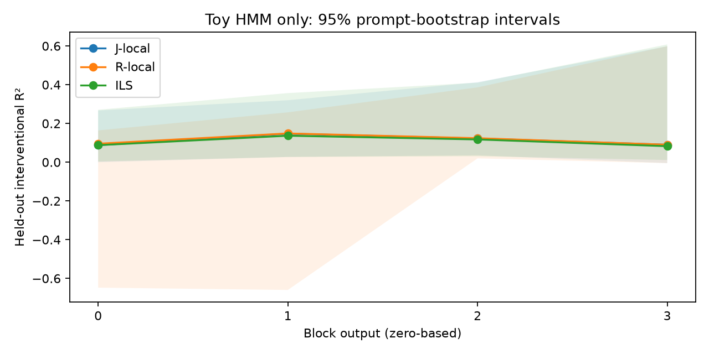
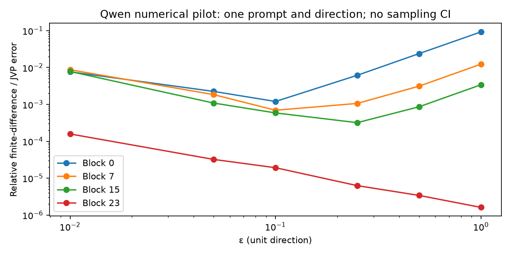

# Preliminary research results

These results describe validation pilots, not a completed Qwen interpretability
study. The full WikiText baseline comparison, label-tuned J++, calibration,
trained Qwen transcoders, full attribution graphs, causal random-direction gates,
phrase evaluation, and planted-organism stress tests have not been run.

## Toy HMM

A four-layer, d=16 transformer was trained for 200 batches of 8 × 128 tokens
(204,800 token presentations), seed 17. The vocabulary has 14 tokens, including
observations and occasional STATE/id reports. Evaluation uses separate prompts
and donors. Held-out report accuracy was 83.48%, with CE 1.5292.

Each layer used 128 donor interventions, epsilon .05, and 40 held-out prompts.
All four horizon responses are stored; the table evaluates gamma=1. J-local and
R-local are local implementations, not reference-fitted baselines. ILS selects
its I/J/R prior, ridge penalty and ridge/Huber/MoM estimator through five-fold
prompt CV. Fold-specific J/R priors exclude validation-prompt Jacobians.

Intervals are 95% bootstrap intervals over 200 resamples of held-out prompts.
They do not capture training-seed uncertainty. Recall@10 is permissive with a
14-token vocabulary. All top-1 recalls are zero; a degenerate bootstrap interval
is not proof of zero population recall. ILS and J/R R² intervals overlap;
there is no supported improvement claim.

| Block | Lens | R² [95% CI] | Recall@1 | Recall@10 [95% CI] |
|---|---|---|---|---|
| 0 | logit | -21.588 [-205.212, -7.547] | 0.000 | 0.725 [0.575, 0.850] |
| 0 | J-local | 0.088 [0.000, 0.267] | 0.000 | 0.975 [0.925, 1.000] |
| 0 | R-local | 0.095 [-0.648, 0.164] | 0.000 | 0.825 [0.700, 0.925] |
| 0 | ILS | 0.088 [0.004, 0.271] | 0.000 | 0.975 [0.925, 1.000] |
| 1 | logit | -31.722 [-261.257, -12.184] | 0.000 | 0.675 [0.549, 0.801] |
| 1 | J-local | 0.147 [0.027, 0.320] | 0.000 | 0.975 [0.925, 1.000] |
| 1 | R-local | 0.148 [-0.660, 0.257] | 0.000 | 0.725 [0.575, 0.850] |
| 1 | ILS | 0.137 [0.027, 0.357] | 0.000 | 0.725 [0.575, 0.850] |
| 2 | logit | -18.707 [-268.012, -5.524] | 0.000 | 0.600 [0.475, 0.750] |
| 2 | J-local | 0.123 [0.036, 0.413] | 0.000 | 0.700 [0.575, 0.825] |
| 2 | R-local | 0.124 [0.020, 0.386] | 0.000 | 0.600 [0.475, 0.750] |
| 2 | ILS | 0.117 [0.031, 0.411] | 0.000 | 0.700 [0.575, 0.825] |
| 3 | logit | -21.752 [-808.230, -6.097] | 0.000 | 0.225 [0.125, 0.351] |
| 3 | J-local | 0.090 [-0.005, 0.599] | 0.000 | 0.225 [0.125, 0.351] |
| 3 | R-local | 0.090 [-0.005, 0.599] | 0.000 | 0.225 [0.125, 0.351] |
| 3 | ILS | 0.083 [0.011, 0.608] | 0.000 | 0.275 [0.150, 0.425] |

At the final block, the normalized uniform-horizon effect is delta/(127−t).
Variation in source position therefore changes the true map even in this case.
Low coverage here is not by itself evidence of nonlinear network curvature.

An initial implementation reused full-fitting-prompt J/R priors inside CV.
This was corrected to use only training-fold prompts. Included results come
from the corrected rerun with unchanged seeds, data and hyperparameter grid;
no readout evaluation labels were used for selection.

## Qwen numerical pilot

One synthetic repeated passage, 128 tokens, one unit isotropic direction,
source position 32, layers 0/7/15/23, and epsilons .01/.05/.1/.25/.5/1.0 were
used with Qwen2.5-0.5B-Instruct in fp32. At epsilon .01, relative errors between
antithetic effects and local JVPs were about .76–.87% at the three earlier
sites. This tests numerical behavior, not interventional lens R² or causal
selectivity. There is no sampling CI for a single prompt and direction.

The pilot took 14.51 seconds with approximately 3.65 GiB peak RSS on CPU. Median
full-replay collection took about .48 seconds per antithetic pair. A naive
7168 × 24 × 6 collection would therefore take about 5.7 CPU-days, excluding
fitting and evaluation. This is an extrapolation, not a completed run.

## Validation and limitations

The tests exercise quadratic antithetic exactness, finite differences/JVPs,
causality, closed-form/iterative ridge agreement, Weiszfeld, LRP forward
preservation, frozen-support feature edges, and exact clean substitution with
an error term. The optional upstream hook comparison verifies block-output and
pre-final-norm conventions when the reference checkout is present.

The isotropic/J equivalence test is a synthetic linear-map check, not the
required nonlinear Qwen equivalence result. The frozen transcoder test is not
a full frozen-attention graph validation. The clean error-term CE test is not
a measurement of trained-transcoder reconstruction quality. Random-control,
calibration, concept, contrast and phrase helpers have not been validated as
complete research workflows. No causal selectivity claim is made.

## Research questions

| Question | Supported answer |
|---|---|
| Does ILS beat J/R? | Unknown for Qwen; toy intervals overlap. |
| Does ILS match label-tuned J++? | Unknown; J++ not run. |
| Do lens interventions beat random directions? | Unknown for every lens. |
| Does the concept lens separate horizons? | Not evaluated. |
| Which tool detects a planted trait? | No planted organism result. |
| Is early disagreement rotation or curvature? | Not evaluated; horizon scaling is also a confound. |
| What fraction is dark matter? | Unknown; graph completeness is not measured. |
| Does Qwen show workspace-like structure? | No defensible conclusion from these pilots. |

Budget closure and case-level dark-matter lists cannot be supplied without
full graph completeness measurements. Missing measurements are unknown, not
zero. The absence of top-1 state readout in the toy is a narrow negative
finding despite its learned report behavior, not a conclusion about Qwen.

Config files and artifact metadata record seeds, budgets and conventions.
Observed environment versions are in requirements-observed.txt; reference
sources and their conventions are documented in REFERENCES.md.
